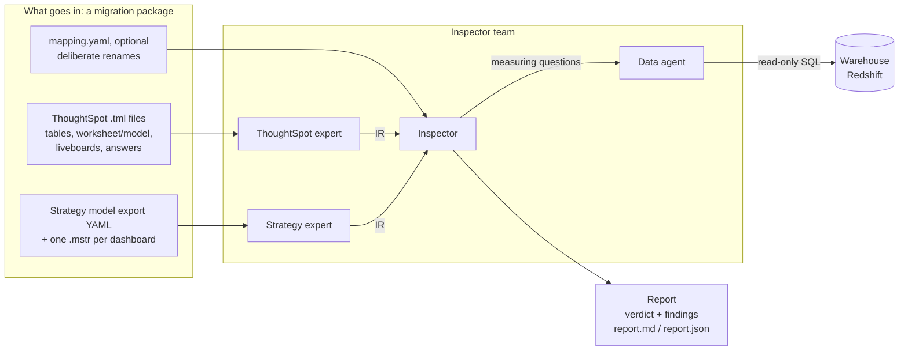
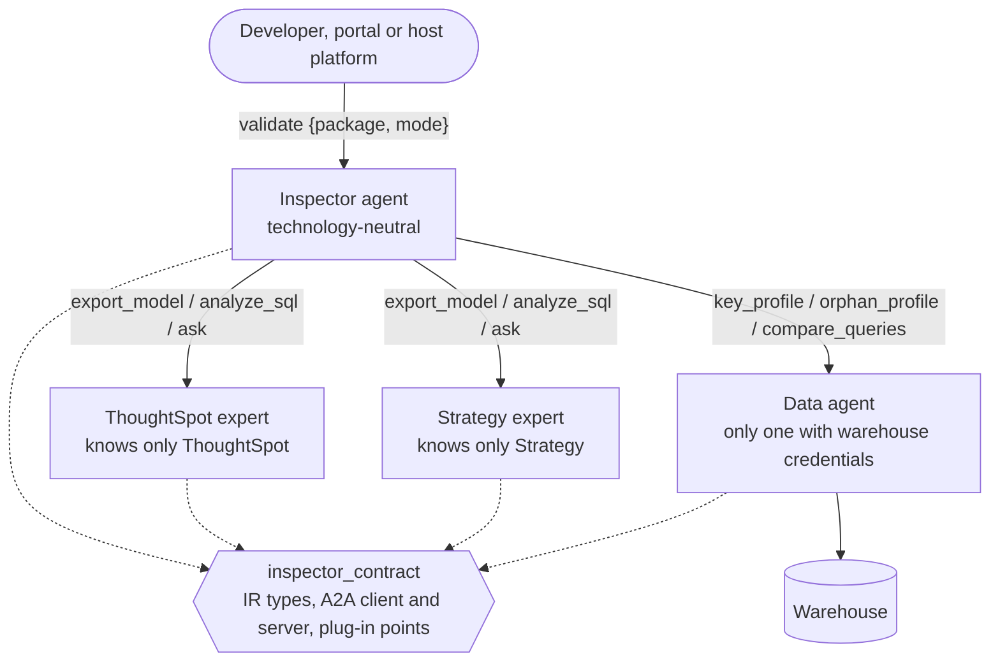

# Inspector

**An agentic validator for ThoughtSpot → Strategy (MicroStrategy Mosaic) migrations.** For each migrated model and
dashboard, Inspector checks that the Strategy version produces the same numbers as the ThoughtSpot original, explains
every difference in plain words, and proves what it calls equal. It is the first-level check before human review.

It is a **generic prototype**: storage, the warehouse connection, model provider, agent discovery and tracing are
plug-in points, so the same code runs on a laptop and inside a host platform such as Amazon Bedrock AgentCore.

---

## In one picture



1. Each **expert** reads only its own tool's files and translates them into a common, tool-neutral description: the **IR**.
2. The **Inspector** compares the two IRs. Deterministic rules run first, then data checks against the warehouse, then
   an LLM agent investigates what is still open, records findings with evidence and writes the explanation.
3. The **data agent** is the only one with warehouse access. It runs guarded, read-only measurements
   (key uniqueness, orphan rows, both sides' numbers side by side).
4. The **verdict** (Ready / Not ready / Needs review) is computed from the findings by code, never chosen by the model.

---

## The agent team

Four independent agents, each its own package, process and (on AWS) AgentCore runtime. They talk over the
**A2A** (Agent-to-Agent) protocol and share only one small package, `inspector_contract`.



Two kinds of request go between agents:

- **Structured skills** (`export_model`, `key_profile`, …): JSON in, JSON out, answered by code, never by an LLM.
- **Conversation** (`ask`): a question in plain text, answered by that agent's own LLM agent. The Inspector uses
  this to ask an expert what a construct means in its tool.

Adding another BI tool later means adding one expert that can `export_model` to IR. The Inspector does not change.

---

## One validation run

```mermaid
sequenceDiagram
    autonumber
    participant C as Caller
    participant I as Inspector
    participant E as Experts (ThoughtSpot, Strategy)
    participant D as Data agent
    participant L as Ledger (code)

    C->>I: validate {package, mode: agent}
    I->>E: export_model (each reads its own side)
    E-->>I: IR: models, fields, joins, filters, dashboards
    Note over I: Rule sweep (code): about two dozen checks produce leads
    I->>D: data checks the rules already defined
    D-->>I: measurements (e.g. "19,145 keys repeat")
    Note over I,L: Leads that data settles are fixed facts
    loop agent turns (LLM)
        I->>E: ask / analyze_sql (when meaning is unclear)
        I->>D: more data probes
        I->>L: record_finding (needs evidence; ledger may refuse)
    end
    I->>L: finalize_report (refused while leads are open)
    L-->>I: verdict computed from findings
    I-->>C: report (JSON + Markdown), run folder
```

Three modes: `rules` (code only), `rules+data` (code plus warehouse, no LLM) and `agent` (all of the above plus the
LLM). Rules-only and rules+data are fast and deterministic. The agent adds investigation and the written explanation.

**What keeps it honest**

- **No pass without proof.** A blocking item can only pass on identical definitions, a rule's proof, or matching data.
- **Code owns the facts, the agent owns the words.** Statuses, severities, counts and the verdict come from the ledger.
  The agent writes the brief, titles, "why it matters" and "what to do".
- **Unreadable is never fine.** A file that cannot be read is a blocking `PK-01` finding naming the file. What
  cannot be decided is `UNVERIFIED`, never `PASS`.

---

## Repository layout

```text
packages/
  inspector_contract/   shared: IR types, A2A client/server, progress logging, plug-in loader
  thoughtspot_agent/    ThoughtSpot expert: TML and formula reader, SQL analyser
  strategy_agent/       Strategy expert: model YAML reader, .mstr dashboard decoder (tools/mstr_reader), SQL analyser
  inspector_agent/      Inspector: rule sweep, matching, lineage, joins, query compiler, data probes, ledger, report
  data_agent/           data agent: SQL guard, warehouse access (plug-in backends), profiler, reconciler
  inspector_portal/     developer portal: upload packages, run validations, read reports (local tool)
synthetic/              generator of 17 test scenarios (S01-S17) with ground truth, and the seeded warehouse
site/                   documentation site (Astro Starlight)
infra/runpod/           script to start a GPU pod serving an open model for local testing
docs/DESIGN.md          original design notes
```

Each agent keeps its logic in `tools/<tool>/` folders that do not depend on the agent, so a tool can move elsewhere
unchanged.

---

## Getting started

Requirements: Python 3.12 and [uv](https://docs.astral.sh/uv/). Docker is optional.

```bash
uv sync --all-packages
cp .env.example .env            # models, AWS, warehouse; every variable is described there
```

**Without Docker: one command, everything in one process**

```bash
uv run inspector-validate synthetic/packages/S07 --rules-only --in-process
uv run --env-file .env inspector-validate synthetic/packages/S04 --in-process          # with the LLM agent
```

**With Docker: the four agents as servers, plus the synthetic warehouse**

```bash
cd synthetic && uv run inspector-synth warehouse && cd ..    # warehouse seed files, first time only
docker compose up -d                                         # agents :9000-9003, warehouse :5439
docker compose logs -f inspector-agent                       # progress, step by step
uv run python -c "from inspector_contract.a2a import A2AClient; \
  r = A2AClient('http://localhost:9000/').call('validate', {'package': '/packages/S04', 'mode': 'rules+data'}); \
  print(r['verdict'], r['run_folder'])"
```

Optional: `docker compose --profile portal up -d` (portal at http://localhost:8501) and
`docker compose --profile docs up -d` (documentation at http://localhost:4321).

**Tests**

```bash
docker compose up -d warehouse                                # the data tests need it
uv run pytest -q packages synthetic                           # ~450 tests, a few minutes
INSPECTOR_LIVE_EVAL=1 uv run --env-file .env pytest -q packages/inspector_agent/tests/test_agent_eval.py   # live LLM, slow
```

---

## Plugging into a real environment

| Concern | Default here | How a host changes it |
|---|---|---|
| Model | RunPod vLLM (`INSPECTOR_LLM_API_BASE`) | leave it empty to use Amazon Bedrock, or pass any Strands model to `run_validation(..., model=...)` |
| Package input | local folder or zip | `s3://bucket/prefix/` or `s3://bucket/key.zip`; others via `register_reader` |
| Report output | `INSPECTOR_RUNS_DIR=/runs` | `s3://bucket/prefix`; others via `register_writer` |
| Warehouse | direct Postgres/Redshift connection | `WAREHOUSE_BACKEND` + `register_backend` (e.g. Redshift Data API with Secrets Manager) |
| Finding the other agents | URLs (`INSPECTOR_*_AGENT_URL`) | AgentCore runtime ARNs, or a registry lookup via `register(...)` |
| Auth between agents | none | `INSPECTOR_A2A_AUTH=sigv4` |
| Tracing | none | run each agent under `opentelemetry-instrument` |
| Extensions | none | `INSPECTOR_PLUGINS=my_project.module` is imported at start-up |

Details: `.env.example`, and the documentation pages *Team & A2A*, *Runtime*, *Migration package*, *Data agent* and
*Seeing a run*.

---

## Status and known limits

- Model, dashboard and data checks run on all 17 synthetic scenarios, and the verdicts match the ground truth.
- The `.mstr` decoder was checked against 81 public demo dashboards (see `packages/strategy_agent/strategy_agent/tools/mstr_reader/README.md`).
  Not decoded yet: chart types, filter scope, Count vs Count Distinct (always flagged for confirmation),
  qualification filter values.
- Report wording depends on the model. With Qwen3-32B the structure is right but fix advice and root-cause linking
  are weaker; a stronger model (e.g. on Bedrock) is expected to do better.

---

## Glossary

**Core ideas**

| Term | Meaning |
|---|---|
| **IR** (Intermediate Representation) | The tool-neutral description of a semantic model and its dashboards that both experts produce: tables, fields (attributes and measures), their expressions down to warehouse columns, joins with type and keys, filters, and each visualization's query (dimensions, measures, filters, sort, top-N). Because both sides arrive in the same shape, the Inspector compares *meaning* without knowing ThoughtSpot or Strategy. Defined in `inspector_contract/ir.py`. |
| **Migration package** | Everything about one migrated model: the ThoughtSpot `.tml` files, the Strategy model export and `.mstr` dashboards, an optional `manifest.yaml` and `mapping.yaml`. A folder, a zip, or an S3 location. |
| **Expert** | An agent that knows exactly one BI tool, reads its files and exports them as IR (ThoughtSpot expert, Strategy expert). |
| **Inspector** | The technology-neutral agent that compares the two IRs and produces the report. |
| **Data agent** | The only agent with warehouse credentials. It runs guarded, read-only measurements for the others. |
| **Rule sweep** | The deterministic first pass: about two dozen checks in code that compare the two IRs and produce leads. |
| **Lead** | A rule's suspicion or proof about one object (`L01`, `L02`, …). Leads are not verdicts: the agent confirms, refines or groups them, unless data has already settled them. |
| **Data probe / data check** | A measurement in the warehouse that settles a question the definitions cannot: is a join key unique, do orphan rows exist, do both definitions return the same numbers. |
| **Settled by data** | A lead decided by a data probe before the agent starts. The agent may explain it but cannot overturn it. |
| **Finding** | One recorded conclusion in the report (`F-001`, …): check, severity, status, both sides' objects, explanation, fix. One finding per root cause, with the other affected objects listed as symptoms. |
| **Evidence** | Every tool result the agent sees gets an id (`E1`, `E2`, …). A finding must cite the evidence it rests on. |
| **Ledger** | The code that records findings and enforces the rules: evidence required, no pass without proof, verdict computed. |
| **Verdict** | `READY`: nothing blocks. `NOT_READY`: at least one blocking difference is proven. `NEEDS_REVIEW`: nothing proven wrong, but something that could change numbers is unconfirmed. |
| **Severity** | `BLOCKER`: can change a number. `WARNING`: might, or could not be confirmed. `LOW`: cosmetic. `INFO`: context only. |
| **Status** | `PASS`: proven the same. `FAIL`: proven different. `UNVERIFIED`: could not be decided with the available files and data. |
| **Latent** | A proven difference in the definitions that today's data happens not to show. Still a FAIL: tomorrow's data may differ. |
| **Check ids** | Families: `CV` coverage, `LN` lineage, `DT` data types, `JN` joins, `AG` aggregation, `FL` filters, `FX` formulas, `DB` dashboards, `LF` look & feel, `PK` package could not be read. Full list on the *Check catalogue* page. |

**ThoughtSpot and Strategy terms**

| Term | Meaning |
|---|---|
| **TML** | ThoughtSpot Modeling Language: the YAML files ThoughtSpot exports for tables, worksheets/models, liveboards and answers. |
| **Worksheet / Model** | ThoughtSpot's semantic layer over warehouse tables: joins, columns, formulas. |
| **Liveboard / Answer** | ThoughtSpot dashboards and saved searches. |
| **Mosaic model export** | The Strategy semantic model as one YAML file: tables, attributes, fact metrics, metrics, settings. |
| **`.mstr`** | A Strategy dashboard file: a zip holding a binary `.delta` stream (the definition) and cube data. Undocumented; decoded by `strategy_agent/tools/mstr_reader` (its README holds the format knowledge). |
| **Freeform SQL** | A Strategy table defined by hand-written SQL. Its joins and filters apply to every query. |
| **Fan-out** | A join to a table with several rows per key repeats rows, so sums are inflated. |
| **Chasm trap** | Two fact tables combined through a shared dimension, so each is multiplied by the other. |

**Platform terms**

| Term | Meaning |
|---|---|
| **A2A** | Agent-to-Agent protocol: agents as HTTP servers that exchange messages; each publishes an **agent card** (name, skills, address) at `/.well-known/agent-card.json`. |
| **Strands** | The agent framework (AWS Strands Agents SDK) each agent's LLM loop is built with. |
| **AgentCore** | Amazon Bedrock AgentCore: one managed runtime per agent, addressed by an ARN; calls between runtimes are signed with **SigV4** (AWS request signing). |
| **AWS Agent Registry** | A catalogue of agent cards, used to find other agents at start-up. Plugs in through the client `register(...)` hooks. |
| **Synthetic scenarios** | `S01`–`S17`: generated migrations, each with a planted defect (or none) and its **ground truth**, the answer key the tests compare against. |
| **Run folder** | What each validation leaves behind: `report.md`, `report.json`, `run.json`. |
